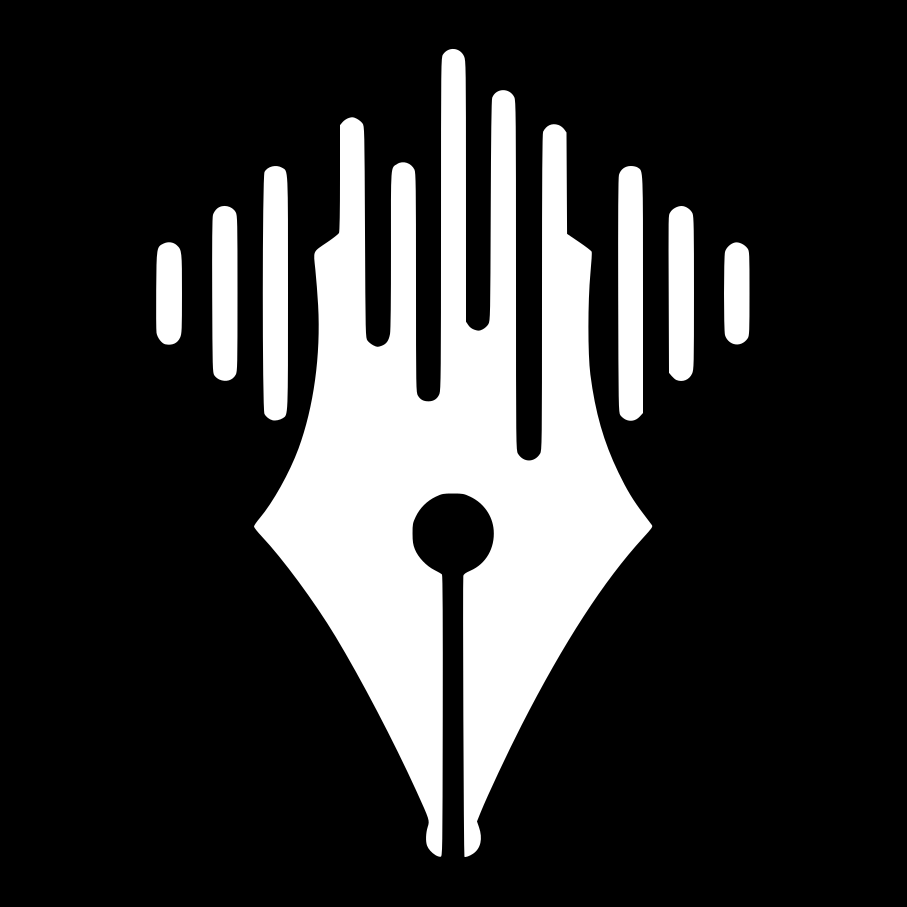

# Voinc

<p align="center"></p>

Local voice dictation and transcription for macOS, Windows and Linux. Hold a key, speak, and it pastes — or transcribe an existing recording from the command line:

```
voinc transcribe meeting.m4a
```

Everything runs on your device by default: the first run downloads a speech
model, and after that nothing leaves your machine. The one cloud option —
Google Transcribe, Google's Gemini speech models behind your own Gemini API
key — lives in Labs, off by default: turn it on, add your key, and dictation
goes to Google instead.

## Downloads

Stable builds are published on the [GitHub releases page](https://github.com/dishanagalawatta/voinc/releases) for macOS (Apple silicon), Windows (x64 and ARM64) and Linux (x64 and ARM64, as executables, `.deb` and `.rpm`).

## Command line

`voinc transcribe` prints a recording's transcript and reads WAV, AIFF, CAF, FLAC, MP3, Ogg, WebM and MP4/M4A/MOV, including a video's soundtrack. The same `voinc` binary controls the running app (`voinc status`, `voinc dictation`, `voinc settings`); see `docs/cli.md`.

## What voinc is

Voinc is a community fork of [Hex](https://github.com/anomalyco/hex) by Anomaly — local voice dictation, MIT licensed. The fork tracks Hex's stable releases automatically:

- `main` is a pristine mirror of the upstream release tags (fast-forward only).
- the `voinc` branch is regenerated from each new upstream tag by applying `.voinc/rebrand.sh` plus the small patch set in `.voinc/patches/` — a daily GitHub Action opens a pull request with the update.
- speech models are downloaded from the same sources upstream uses; updates are handled through GitHub releases rather than an in-app updater.

See `.voinc/rebrand.sh`, `.voinc/assets/README.md` and `NOTICE.md` for details of the fork mechanics, branding, and attribution.

## Branding

The fork's mark is a fountain-pen nib with a voice waveform, drawn in `assets/logo/logo.svg` (on a black plate) and `assets/logo/logo-transparent.svg` (white on alpha). Every icon the app shows is derived from it: the Linux hicolor set, the
Windows `.ico`, installer and tray rasters, and the macOS Icon Composer
layer. Sizes below 64 px and the tray use the nib alone — the waveform's thin
bars merge into noise that small. Icons the app itself writes into the user's
icon theme carry an `X-Hex-Managed=true` marker inside the PNG, so Voinc
replaces — and the uninstaller removes — only the icons it wrote, never one
you made. How the assets are derived and regenerated:
`.voinc/assets/README.md`.

## Building from source (Linux)

```sh
sudo pacman -S --needed base-devel git rustup python alsa-lib curl jq openssl xxd \
  util-linux libxkbcommon libxkbcommon-x11 libx11 libxcb openblas \
  vulkan-headers vulkan-icd-loader shaderc spirv-headers clang cmake pkgconf \
  wl-clipboard wtype
rustup default stable

git clone https://github.com/dishanagalawatta/voinc.git
cd voinc
./scripts/install-linux.sh
voinc model install
voinc
```

On other platforms see `docs/windows.md` and the macOS build scripts (`scripts/build-app.sh`). A Nix flake is available for Linux (`nix develop`).

## License

MIT — see `LICENSE` (inherited from upstream) and `NOTICE.md`.
